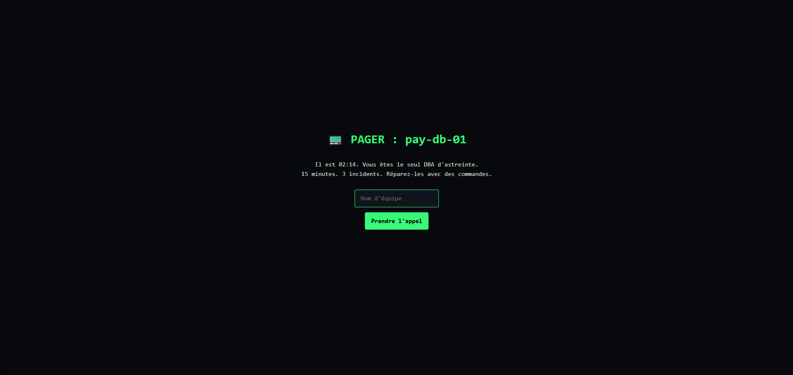
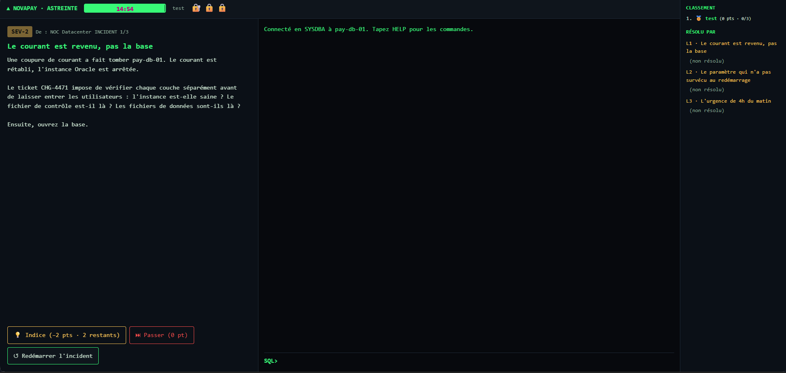

# Oracle Escape Room 

A gamified, browser-based Oracle DBA training tool. Teams are dropped into a simulated `SQL*Plus` console and must resolve three realistic incidents on a fictional payment-processing database (`pay-db-01`): starting up a crashed instance, fixing a lost parameter change, and performing crash recovery after an emergency abort.

Everything runs locally and safely. SQL commands typed in the console are never sent to a real Oracle server; they are parsed and handled in memory by `engine.py`. Optionally, the simulator can pull read-only metadata from an actual Oracle instance (`V$SGA`, `V$CONTROLFILE`, etc.) to use authentic values.

## Screenshots

| Incident Pager View | Simulated SQL*Plus Console |
| --- | --- |
|  |  |

## Features

- **3 Incident Scenarios**: Staged objectives covering lifecycle startup steps (`NOMOUNT` -> `MOUNT` -> `OPEN`), `PFILE`/`SPFILE` scope settings, and crash recovery.
- **Simulated SQL*Plus Console**: Supports standard operational commands (`STARTUP`, `SHUTDOWN`, `ALTER DATABASE`, `ALTER SYSTEM SET`), inspection commands (`SHOW PARAMETER`, `HOST tail alert`), and `SELECT` queries on dynamic performance views.
- **Realistic Oracle Error Messages**: Emulates real error codes (`ORA-01034`, `ORA-01507`, `ORA-01081`, `ORA-00904`, etc.) so experience translates directly to real environments.
- **Timed Challenge Engine**: 15-minute countdown timer with a live multi-team leaderboard, point-deducting hint system, level skips/retries, and technical debriefs following each level.
- **Isolated State Management**: Each registered team operates in its own isolated simulation instance.
- **Automated Validation**: Levels unlock only when the correct sequence of operational and verification commands is executed.
- **Test Coverage**: Includes `test_playthrough.py` to validate correct operational sequences and common incorrect paths.

## Tech Stack

- **Backend**: Python 3.10+ using FastAPI and Uvicorn
- **Frontend**: Vanilla HTML5/JS (single static `index.html`, no build step, terminal theme)
- **Database Connectivity (Optional)**: `python-oracledb` for querying real Oracle metadata
- **Configuration**: `python-dotenv`

> Note: Python 3.10 or higher is required due to the use of modern type union syntax (`int | None`).

## Quick Start

### 1. Repository Setup

Clone the repository and navigate into the project directory:

```bash
git clone https://github.com/eya568/escapeRoom.git
cd escapeRoom
```

### 2. Environment & Dependencies

Create a virtual environment, activate it, and install the required dependencies:

```bash
python -m venv .venv
source .venv/bin/activate  # On Windows use: .venv\Scripts\activate
pip install -r requirements.txt
```

### 3. Configuration

Copy the sample environment file:

```bash
cp .env.example .env
```

### 4. Running the Application

Start the local server using Uvicorn:

```bash
uvicorn app:app --reload
```

Once running, access the application in your browser at `http://localhost:8000`.

## Administrative Endpoints

When the server starts, administrative URLs and your generated `ADMIN_KEY` are output to the terminal:

- **Start Game Countdown**: `GET /api/admin/start?key=<ADMIN_KEY>`
- **Reset Teams & Progress**: `GET /api/admin/reset?key=<ADMIN_KEY>`

## Project Structure

```text
.
├── app.py                 # FastAPI application routes, game loop, and leaderboard logic
├── engine.py              # In-memory SQL*Plus simulation engine
├── levels.py              # Incident setup, check logic, and technical debriefs
├── requirements.txt       # Python package dependencies
├── test_playthrough.py    # Automated tests for level progression
├── static/
│   └── index.html         # Single-page terminal frontend
└── image/                 # Documentation assets
```
